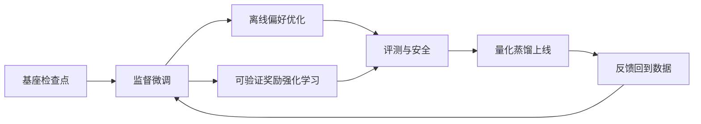

# 后训练底层技术

预训练做完的模型，本质上是一个很擅长「往下续写」的底座：你给它半段文章，它能接着写；但你直接问它一个问题，它可能会接着编十个同类问题，而不是老老实实回答。

后训练（Post-Training）接在预训练检查点之后。它用更少、更干净、带好坏反馈的数据，把模型从「只会续写」改成「能听懂要求、会用工具、会一步步做题、知道什么话不能说」。算力开销通常只有预训练的零头，但模型上线后好不好用，几乎全看这一段。

## 链路

实际工程里最常用的两条配方：

- **通用对话**：先做监督微调（学会问答格式），再做 DPO、IPO、KTO、ORPO、SimPO 或 PPO（学会哪种回答更讨人喜欢、更稳妥）。
- **推理与智能体**：先用少量长思维链做冷启动监督微调（让模型知道可以把草稿写出来），再用 GRPO、DAPO 或 RLOO 做强化学习（由答案核对器、单元测试、编译器直接判对错），最后补一轮通用偏好对齐，让它既会做题，又能正常按要求说话。

## 监督微调

监督微调（SFT）就是拿标准答案带模型做一遍题。损失函数和预训练一样，仍然是**下一词交叉熵**——看模型预测下一个词的概率离标准答案差多远。

区别只在一点：用户提问的那半截用 **loss mask（损失掩码）** 盖住，不计入损失，只让模型为「回答的那半截」负责。否则模型会把精力花在背诵「用户爱怎么提问」上。多轮对话、工具调用（JSON 参数）、长思维链，底层都是同一条交叉熵损失，差别只是塞进去的示范数据长什么样。

**全参数微调**直接更新所有权重，能力上限最高，适合作为后面偏好对齐和强化学习的起点。代价是显存占用大：除了权重和梯度，Adam 优化器还要为每个参数存一阶矩和二阶矩（两份状态），显存主要被这一块吃掉。

### LoRA

大模型的权重矩阵虽然很大，但微调时真正发生的变化，往往集中在少数几个方向上。LoRA 的做法是：**把原来的权重 \(W\) 冻住不动，只在旁边挂两个很瘦的小矩阵 \(B\) 和 \(A\)**，只训练增量 \(\Delta W = BA\)。

中间的秩 \(r\) 远小于隐藏层维度，所以需要训练的参数量和 Adam 优化器状态都缩小了几个数量级。不同业务可以共用同一个底座、各自挂一份很小的适配器；上线推理前直接把 \(BA\) 加回 \(W\)，不会多花一分钱推理时延。

- 论文：[LoRA: Low-Rank Adaptation of Large Language Models](https://arxiv.org/abs/2106.09685)
- 原始实现：[microsoft/LoRA](https://github.com/microsoft/LoRA)
- 现在最常用的入口：[huggingface/peft](https://github.com/huggingface/peft)

### QLoRA

LoRA 省掉了优化器状态，但被冻住的基座权重本身还占着不少显存。QLoRA 更进一步：**把冻结的基座权重压成 4 bit（NF4 正态浮点格式），并做双重量化**，再在上面挂 LoRA；前向反向时按需把那块权重临时解压成高精度算梯度，梯度只更新 LoRA 小矩阵。

这样一来，原本要多卡才能塞下的模型，单张消费级或常规训练卡就能微调。

- 论文：[QLoRA: Efficient Finetuning of Quantized LLMs](https://arxiv.org/abs/2305.14314)
- 原始实现：[artidoro/qlora](https://github.com/artidoro/qlora)
- 单卡手写内核加速版：[unslothai/unsloth](https://github.com/unslothai/unsloth)

### DoRA

把权重拆成「方向」和「长度（幅度）」两件事来看：全参数微调时，两者是分开变化的；而普通 LoRA 往往把两者绑在一起改。DoRA **把幅度单独拎出来当成一个可训练向量，方向部分仍然交给 LoRA 做低秩更新**。同样的秩 \(r\) 下，训练表现通常更接近全参微调。

- 论文：[DoRA: Weight-Decomposed Low-Rank Adaptation](https://arxiv.org/abs/2402.09353)
- 原始实现：[NVlabs/DoRA](https://github.com/NVlabs/DoRA)
- 训练入口：PEFT 已内置 DoRA 开关

### rsLoRA

普通 LoRA 在把增量加回主干时，习惯乘一个缩放系数 \(\alpha / r\)。这会带来一个怪现象：你想通过把秩 \(r\) 调大来提升拟合能力，结果除数变大了，每一步的有效更新反而被压扁了。rsLoRA 把分母改成 \(\sqrt{r}\)，**乘 \(\alpha / \sqrt{r}\)**，让加大秩的时候梯度尺度依然稳定，大秩真正能发挥作用。

- 论文：[A Rank Stabilization Scaling Factor for Fine-Tuning with LoRA](https://arxiv.org/abs/2312.03732)
- 代码入口：[huggingface/peft](https://github.com/huggingface/peft)

### PiSSA

普通 LoRA 用随机高斯和零矩阵初始化 \(A\)、\(B\)，训练刚开始时是在噪音方向上摸索。PiSSA 先对原权重矩阵做奇异值分解（SVD），**把最重要的主奇异值和奇异向量直接放进可训练的 \(A\)、\(B\) 里**，把次要的残差留在冻结矩阵里。相当于一上来就拧最关键的旋钮，收敛比随机起步更快。

- 论文：[PiSSA: Principal Singular Values and Singular Vectors Adaptation of Large Language Models](https://arxiv.org/abs/2404.02948)
- 代码入口：PEFT、LlamaFactory、ms-swift

### AdaLoRA

不同层、不同矩阵（比如注意力里的 Value 矩阵和前馈层）对微调的敏感度完全不一样，每一层都分一样大的秩 \(r\) 其实很浪费。AdaLoRA 把增量写成类 SVD 的形式，在训练过程中边跑边评估各个方向的重要性：**不重要的方向直接剪掉，把省下来的参数预算分给更吃紧的层**。

- 论文：[AdaLoRA: Adaptive Budget Allocation for Parameter-Efficient Fine-Tuning](https://arxiv.org/abs/2303.10512)
- 代码入口：[huggingface/peft](https://github.com/huggingface/peft)

### GaLore

如果你想保留「全参数都能更新」的上限，但显存又装不下全量 Adam 状态，可以用 GaLore。它不冻结原权重，而是利用「梯度矩阵本身也是低秩的」这一性质，**先把梯度投影到低维子空间，只在这个小空间里维护 Adam 的一阶、二阶动量**，更新时再投影回原尺寸加到全量权重上，并且隔一段步数换一次投影方向。它省的是优化器状态显存，模型本身仍是全参数训练。

- 论文：[GaLore: Memory-Efficient LLM Training by Gradient Low-Rank Projection](https://arxiv.org/abs/2403.03507)

### NEFTune

指令微调数据集不大时，模型很容易死记硬背训练样本的句式。NEFTune 的做法极其简单：**在训练的前向过程里，往词嵌入（Embedding）向量上加一点均匀分布的随机噪声**，上线推理时关掉。就这么一步，能明显减轻对小样本的过拟合，让回答更放得开。

- 论文：[NEFTune: Noisy Embeddings Improve Instruction Finetuning](https://arxiv.org/abs/2310.05914)
- 代码入口：TRL、LlamaFactory、ms-swift 均提供参数开关

### 序列打包

监督微调的数据长短不一：有的只有几十个词，有的有几千个词。如果老老实实按最长样本补零（padding），GPU 一大半时间都在算无意义的零。

**序列打包（Packing）** 把多条短样本头尾相接拼进同一条长序列里，同时修改位置编号和注意力掩码（attention mask），保证第 2 条样本看不见第 1 条样本的内容。这是把 SFT 吞吐（每秒有效 token 数）拉起来的常规操作，TRL、LlamaFactory、ms-swift 都直接支持。

### 拒绝采样微调与 STaR

在数学和代码任务里，直接上强化学习之前，常常先做一轮**拒绝采样微调（RFT）**：拿当前模型对同一道题采样几十条解法，用答案核对器或单测筛掉错的，只留做对的轨迹当教材，再做一遍监督微调。

**STaR** 把这件事做成了循环自举：让模型先试着写推理步骤，做对的直接收进训练集；做错的，把标准答案塞给它当提示，让它「倒推」出合理的中间步骤，再收进训练集训练下一代。DeepSeek-R1 在正式强化学习前先用少量长思维链做冷启动，走的就是这个思路。

- 论文：[STaR: Bootstrapping Reasoning With Reasoning](https://arxiv.org/abs/2203.14465)
- 推理模型里的冷启动用法见：[DeepSeek-R1](https://arxiv.org/abs/2501.12948)

### 蒸馏

大模型用强化学习把复杂推理能力跑通之后，怎么塞进线上跑得起的小模型？靠蒸馏。

最直接的是**序列级蒸馏**：让教师模型生成回答或完整思维链，学生模型直接拿来做 SFT。但这有个隐患（暴露偏差）：学生训练时看的都是教师写好的完美上文，一旦上线自己生成，写错半句话就接不下去了。

**MiniLLM** 和 **GKD（On-Policy 蒸馏）** 改成让学生自己先生成回答，再让教师在学生的轨迹上逐词给出概率分布纠正（用逆向 KL 或广义 JSD 散度），治的就是「平时背标准答案挺熟，自己上考场就崩」。

- 论文：[MiniLLM: On-Policy Distillation of Large Language Models](https://arxiv.org/abs/2306.08543)
- 论文：[On-Policy Distillation of Language Models: Learning from Self-Generated Mistakes](https://arxiv.org/abs/2306.13649)（GKD）

## 数据从哪来

算法再新，喂进去的数据脏、配比歪，训出来一样不能用。后训练的数据仓通常分成三类分开管：**普通指令数据**（SFT 用）、**好坏对比数据**（偏好优化用）、**带标准答案或单测的题库**（可验证强化学习用）。不管哪一类，都必须和评测集做严格的去重去污染，防止考题漏进教材。

### Self-Instruct

人工写指令又慢又贵。Self-Instruct 先准备一小撮人工写的种子指令，让模型模仿着生出新指令和对应回答，再用规则和相似度过滤掉重复、残缺的样本，塞回池子里继续滚雪球。它立下了一条规矩：**合成数据能不能用，一半看生成，一半看清洗过滤**。

- 论文：[Self-Instruct: Aligning Language Models with Self-Generated Instructions](https://arxiv.org/abs/2212.10560)

### Evol-Instruct

模型自己随便编的题往往太简单。WizardLM 提出的 Evol-Instruct 专门用提示词逼着模型把简单题「进化」成难题：要么**加深**（加约束、加推理步数、把概念具体化），要么**拓宽**（换同类的冷门场景），同时剔除进化失败的无解废题。需要强逻辑和复杂指令遵循时，这套改写法非常管用。

- 论文：[WizardLM: Empowering large pre-trained language models to follow complex instructions](https://arxiv.org/abs/2304.12244)

### Magpie

一个已经对齐好的聊天模型，当你只给它塞进「用户说话前的模板前缀」（比如 `<|start_header_id|>user<|end_header_id|>`），不给任何具体内容时，它会顺着自己学过的套路，自动往下编出一句像模像样的用户提问。Magpie 利用这个特性，**连种子题都不用准备，直接从空模板里成批抽出高质量指令**，再让模型自己作答。

- 论文：[Magpie: Alignment Data Synthesis from Scratch by Prompting Aligned LLMs with Nothing](https://arxiv.org/abs/2406.08464)
- 造数据与人工抽检工具：[argilla-io/distilabel](https://github.com/argilla-io/distilabel)、[argilla-io/argilla](https://github.com/argilla-io/argilla)

## 离线偏好优化

做完 SFT，模型会答话了，但常常啰嗦、生硬，或者偶尔胡编。很多时候人们很难一笔一划写出「完美答案」，却很容易在两条回答里指出「A 比 B 更好」。偏好优化就是用这种比较信号来调整模型。

### Bradley-Terry

这是整个偏好对齐的数学底座。假设每个回答背后有一个隐含的分数 \(r\)，那么回答 \(y_w\) 比 \(y_l\) 更受青睐的概率，就等于两个分数之差经过 sigmoid 函数后的结果：\(\sigma(r(x, y_w) - r(x, y_l))\)。后面的奖励模型训练和 DPO 推导，全是从这个式子长出来的。

- 出处：Bradley, R. A. & Terry, M. E. (1952). Rank analysis of incomplete block designs. *Biometrika*.

### 奖励模型

拿成对的「好回答 \(y_w\) / 坏回答 \(y_l\)」数据，按上面的 Bradley-Terry 公式训练一个打分网络，让它给好回答打的标量分高于坏回答。

打分方式分两种：**结果奖励模型（ORM）** 只在整段话写完后给一个总分；**过程奖励模型（PRM）** 对推理的每一步分别打分。PRM 抓错抓得准，但标注成本高得多。

- 过程监督代表作：[Let's Verify Step by Step](https://arxiv.org/abs/2305.20050)
- 把 SFT、奖励模型、PPO 串成标准三步走的奠基论文：[Training language models to follow instructions with human feedback](https://arxiv.org/abs/2203.02155)（InstructGPT）

### PPO

经典 RLHF 的主力算法。训练时模型自己针对提示词生成回答，奖励模型给分；为了防止模型为了骗高分把语言说崩（Reward Hacking），还要拿一个冻住的 SFT 模型当**参考模型（Reference）**，一旦新模型偏离参考模型太远（KL 散度过大）就扣分；同时用一个**价值模型（Critic）**配合广义优势估计（GAE）来算每一步到底比预期好多少，最后用带裁剪（Clipping）的策略梯度稳步更新。

代价很直观：显存和集群里要同时摆下**策略、参考、奖励、价值四个大模型**，工程同步重，但多轮复杂任务里上限依然很扎实。

- 算法原论文：[Proximal Policy Optimization Algorithms](https://arxiv.org/abs/1707.06347)
- 语言模型完整落地：InstructGPT（见上）
- 早期开源参考：DeepSpeed-Chat，位于 [deepspeedai/DeepSpeed](https://github.com/deepspeedai/DeepSpeed)
- 现在的主力大规模框架：[OpenRLHF/OpenRLHF](https://github.com/OpenRLHF/OpenRLHF)、[verl-project/verl](https://github.com/verl-project/verl)、[NVIDIA-NeMo/RL](https://github.com/NVIDIA-NeMo/RL)

### DPO

PPO 要养四个模型太折腾。DPO 的作者注意到一个数学事实：在「最大化奖励 + 限制相对参考模型的 KL 散度」这个目标下，最优策略 \(\pi^*\) 和奖励函数 \(r\) 之间其实可以互相反解——也就是说，**语言模型自己除以参考模型的对数概率比 \(\beta \log \frac{\pi_\theta(y|x)}{\pi_{\text{ref}}(y|x)}\)，本身就已经是一个隐式的奖励函数**。

把它直接代回 Bradley-Terry 公式，就彻底省掉了单独训练奖励模型和在线采样：只要拿现成的「好回答 / 坏回答」对比数据，算一次分类式的交叉熵损失，就能直接推高好回答概率、压低坏回答概率。\(\beta\) 用来控制离参考模型有多远。

- 论文：[Direct Preference Optimization: Your Language Model is Secretly a Reward Model](https://arxiv.org/abs/2305.18290)
- 原始实现：[eric-mitchell/direct-preference-optimization](https://github.com/eric-mitchell/direct-preference-optimization)
- 工程配方：[huggingface/alignment-handbook](https://github.com/huggingface/alignment-handbook)、[huggingface/trl](https://github.com/huggingface/trl)

### IPO

DPO 有一个隐含毛病：如果在训练集里某条回答每次都赢，Bradley-Terry 目标会要求好坏回答的对数概率差奔着无穷大去，哪怕 KL 惩罚系数 \(\beta\) 设得不小，也容易在有限偏好数据上过拟合。

IPO（Identity Preference Optimization）把這一整类方法抽象成 \(\Psi\)PO 框架，改用平方损失让好坏回答的对数概率比**稳定在一个有限的目标间隔附近**，不再无休止地拉大差距，在偏好数据有噪声或量不够时更抗过拟合。

- 论文：[A General Theoretical Paradigm to Understand Learning from Human Preferences](https://arxiv.org/abs/2310.12036)
- 代码入口：[huggingface/trl](https://github.com/huggingface/trl)

### KTO

现实业务里，攒「同一个问题下的一好一坏两条回答」并不容易，更多时候后台日志里只有用户点的「赞」或「踩」——也就是单条样本的好坏二元标签。

KTO 借用了行为经济学里的前景理论（人对损失比对等量收益更敏感），**不用成对数据，单靠「这条回答合格 / 不合格」就能做对齐**。数据准备成本比 DPO 低一大截。

- 论文：[KTO: Model Alignment as Prospect Theoretic Optimization](https://arxiv.org/abs/2402.01306)
- 原始实现：[ContextualAI/HALOs](https://github.com/ContextualAI/HALOs)
- 代码入口：TRL

### ORPO

传统流程要先做一轮 SFT，存下检查点当参考模型，再开一轮 DPO。ORPO 把两步并成一步：**在正常 SFT 交叉熵损失后面，直接加上一项好坏回答的「优势比（Odds Ratio）」惩罚项**。既不用训两轮，也不用加载那份冻结的参考模型，显存和流程都省了一半。

- 论文：[ORPO: Monolithic Preference Optimization without Reference Model](https://arxiv.org/abs/2403.07691)
- 原始实现：[xfactlab/orpo](https://github.com/xfactlab/orpo)

### SimPO

DPO 训练时优化的是「相对参考模型的概率比」，但上线推理时根本没有参考模型参与，只看模型自己算出来的序列概率，这叫训推不一致；而且长句子的词多，对数概率加起来天生吃亏或占便宜。

SimPO 直接**拿回答中每个词的「平均对数概率（长度归一化）」当隐式奖励**，并加上一个固定胜出间隔 \(\gamma\)。同样不需要参考模型，而且直接治了模型爱靠凑字数刷分的问题。

- 论文：[SimPO: Simple Preference Optimization with a Reference-Free Reward](https://arxiv.org/abs/2405.14734)
- 原始实现：[princeton-nlp/SimPO](https://github.com/princeton-nlp/SimPO)

### 在线偏好

纯离线 DPO 最大的短板是「教材过期」：训到半路，模型自己的说话分布已经变了，但喂给它的还是旧模型当年写出来的正反例。

在线偏好（如 OAIF）改成**边训边让当前模型自己采样写几条回答，交给奖励模型或更强的裁判模型当场判出高下，立刻拿来做 DPO 更新**。它花掉了在线采样的钱，但把离线 DPO 的上限往上抬了一大截。

- 论文：[Direct Language Model Alignment from Online AI Feedback](https://arxiv.org/abs/2402.04792)

### 宪法式 AI

安全对齐如果全靠人工一条条写拒答、标好坏，既慢又容易标准不一。宪法式 AI（Constitutional AI / RLAIF）的做法是先写好十几条明文原则（也就是「宪法」）：第一步让模型按原则自我批评、自己改写出更安全礼貌的回答，拿来做 SFT；第二步让模型按原则对两条回答打分做偏好对比，训练偏好或奖励模型。人工从「苦力标注员」变成了「定规则和抽检的人」。

- 论文：[Constitutional AI: Harmlessness from AI Feedback](https://arxiv.org/abs/2212.08073)

### 过程奖励

一道十步的数学题，最后一步算错了，结果奖励（ORM）只能冷冰冰地给个 0 分，模型并不知道前八步其实是对的、错在第九步。过程奖励模型（PRM）专门给每一个推理步骤打分，不仅训练时信用分配更清楚，推理时配合多路采样搜索（Best-of-N 或树搜索）挑答案也明显更准。

- 论文：[Let's Verify Step by Step](https://arxiv.org/abs/2305.20050)

## 可验证奖励强化学习

当任务变成解数学题、写代码、调工具时，答案对不对根本不用请人类或大模型猜——拿标准答案核对、跑一遍单元测试、过一遍编译器，立刻就能给出板上钉钉的 0 或 1。

把这种**程序可核对的硬信号直接当成强化学习奖励**，就是 **RLVR（可验证奖励强化学习）**。因为裁判不会被模型花言巧语糊弄，模型在海量采样里会自己摸索出验算、反思、换思路等长思维链行为。

### GRPO

PPO 最占显存、最难调的就是那个和主模型一样大的价值网络（Critic）。DeepSeekMath 提出的 GRPO 干脆把 Critic 砍掉了：

针对同一道题，让当前模型一次采样一组回答（比如 \(G=8\) 或 \(16\) 条），拿验证器给每条打分 \(\{r_1, \dots, r_G\}\)，然后直接用**这组分数自己的均值和标准差做标准化**，算出来的相对高低就是每条回答的优势（Advantage）。比同组平均分高的就鼓励，低的就压制，再配上 PPO 式的裁剪和 KL 约束。省掉一整套价值网络后，显存和跨卡同步立刻轻松了很多。

- 论文：[DeepSeekMath: Pushing the Limits of Mathematical Reasoning in Open Language Models](https://arxiv.org/abs/2402.03300)
- 报告仓库：[deepseek-ai/DeepSeek-Math](https://github.com/deepseek-ai/DeepSeek-Math)
- 训练系统：[verl-project/verl](https://github.com/verl-project/verl)、[OpenRLHF/OpenRLHF](https://github.com/OpenRLHF/OpenRLHF)、[huggingface/trl](https://github.com/huggingface/trl)、[modelscope/ms-swift](https://github.com/modelscope/ms-swift)

### RLOO

同样是砍掉 Critic 的思路。RLOO（Leave-One-Out REINFORCE）对同一道题采样 \(K\) 条回答，算第 \(i\) 条回答的基线（Baseline）时，直接取**同组里其余 \(K-1\) 条回答的平均分**。数学上这是无偏估计，方差又比原始 REINFORCE 小得多，实现起来比 PPO 干净得多。

- 论文：[Back to Basics: Revisiting REINFORCE Style Optimization for Learning from Human Feedback in LLMs](https://arxiv.org/abs/2402.14740)
- 代码入口：TRL、OpenRLHF

### REINFORCE++

如果每道题只采样一两条，组内均值就不稳了。REINFORCE++ 同样不用 Critic，但它把参考模型的 KL 惩罚直接折算进奖励，并在**整个全局批次（Global Batch）上做优势归一化**，配合裁剪，在单样本或小分组采样时比朴素方法更稳。

- 论文：[REINFORCE++: Stabilizing Critic-Free Policy Optimization with Global Advantage Normalization](https://arxiv.org/abs/2501.03262)
- 实现：[OpenRLHF/OpenRLHF](https://github.com/OpenRLHF/OpenRLHF)

### DAPO

把 GRPO 放到大规模长思维链训练里真刀真枪跑起来时，会遇到熵坍缩（越训越死板）、长答案梯度被稀释、全对全错空转等问题。字节与清华开源的 DAPO 对症改了四处：

1. **Clip-Higher（上下裁剪解耦）**：把上界裁剪 \(\varepsilon_{\text{high}}\) 放宽，给原本概率很低的探索性词留出涨起来的空间，防止过早失去多样性。
2. **Dynamic Sampling（动态采样）**：如果一道题采出来的一组回答「全对」或「全错」，组内标准差就是 0，算不出梯度；DAPO 直接丢掉这种无效组继续补采，保证每个批次都有真实学习信号。
3. **Token-Level Loss（词级损失）**：不再先按每条回答平均再按组平均，而是按所有 token 统一加权，免得高质量的长推理链因为词数多、单个词权重被摊薄，或者超长废话逃避惩罚。
4. **Overlong Reward Shaping（超长平滑惩罚）**：对接近或撞上长度上限的截断样本做平滑扣分，而不是一刀切硬塞噪点。

- 论文：[DAPO: An Open-Source LLM Reinforcement Learning System at Scale](https://arxiv.org/abs/2503.14476)
- 官方系统：[BytedTsinghua-SIA/DAPO](https://github.com/BytedTsinghua-SIA/DAPO)
- 同款配方在 verl、OpenRLHF 中均可直接开启

### GSPO

GRPO 与 DAPO 在算新旧策略概率比（重要性采样比率）和裁剪时，是在每个 token 上分别算的，但奖励却是整道题做完才给一个总分，粒度和方差并不完全匹配。GSPO 把重要性采样比率和裁剪**整体抬到序列（整段回答）级别**，用几何平均的序列似然比来做裁剪和更新，在大规模以及混合专家（MoE）模型的强化学习里训练更稳。

- 论文：[Group Sequence Policy Optimization](https://arxiv.org/abs/2507.18071)
- 代码：见论文页面及 verl / OpenRLHF / ms-swift 中跟进的实现

### DeepSeek-R1 配方

DeepSeek-R1 把怎么训出强推理模型写成了一套公开的四阶段工程蓝图：

1. 先用几千条高质量长思维链做冷启动 SFT，让模型输出格式规整、可读；
2. 上可验证奖励的 GRPO 强化学习，把数学、代码等硬推理能力拉满；
3. 在强化学习收敛后，通过拒绝采样收集推理轨迹，并混入写作、问答等通用数据做新一轮 SFT；
4. 最后做一轮兼顾有用性与安全性的全场景强化学习对齐。

同时它证明了：把大模型的推理轨迹直接蒸馏给小模型，比让小模型自己从头跑强化学习划算得多。

- 论文：[DeepSeek-R1: Incentivizing Reasoning Capability in LLMs via Reinforcement Learning](https://arxiv.org/abs/2501.12948)
- 报告仓库：[deepseek-ai/DeepSeek-R1](https://github.com/deepseek-ai/DeepSeek-R1)
- 承载这类大规模 RL 数据流的系统论文：[HybridFlow: A Flexible and Efficient RLHF Framework](https://arxiv.org/abs/2409.19256)，对应开源仓 [verl-project/verl](https://github.com/verl-project/verl)

## 长上下文、合并、框架怎么选

### 旋转位置编码与外推

现在主流模型都用 **RoPE（旋转位置编码）**：按词所在的位置，把 Query 和 Key 向量在复平面上转一个角度，词与词的距离自然体现在角度差里。不同维度转得快慢不同（高频分量看局部，低频分量看远距）。

如果训练只见过 4K 长度，直接喂 32K，没见过的大角度会让注意力分数彻底乱掉。把上下文拉长常用这几招：

- **位置插值（PI）**：把长位置按比例压缩回原来训练见过的范围，再做少量微调。论文：[Extending Context Window of Large Language Models via Positional Interpolation](https://arxiv.org/abs/2306.15595)
- **YaRN**：一刀切压缩会把局部高频细节挤糊。YaRN 按频率分段处理——高频不动以保住局部敏锐度，低频做插值，并配一个注意力温度缩放。论文：[YaRN: Efficient Context Window Extension of Large Language Models](https://arxiv.org/abs/2309.00071)
- **调大基频（ABF）**：Code Llama 等直接把 RoPE 的底数从 10000 调大到百万级，再做长文本继续训练。论文：[Code Llama: Open Foundation Models for Code](https://arxiv.org/abs/2308.12950)
- **LongRoPE**：用搜索找每一维最合适的非均匀缩放比例，把窗口推到百万词级。论文：[LongRoPE: Extending LLM Context Window Beyond 2 Million Tokens](https://arxiv.org/abs/2402.13753)
- RoPE 原论文：[RoFormer: Enhanced Transformer with Rotary Position Embedding](https://arxiv.org/abs/2104.09864)

### 权重合并

如果手头基于同一个底座分别训了「代码强」、「数学强」、「说话好听」三个检查点，可以不用重训，直接在参数空间把它们合成一个模型：

- **SLERP**：在球面上对两个模型的权重做平滑插值，比简单加权平均更能保住向量的模长。
- **TIES-Merging**：多个模型往一块合时，先把变化很小的冗余增量清零，再投票统一正负号方向，最后对方向一致的参数求平均，避免互相抵消。
- **DARE**：微调产生的增量 \(\Delta W\) 其实非常稀疏。先把绝大部分增量随机丢掉（置零），再把剩下的按比例放大，这样多个专项模型合在一起时几乎不打架。

合并适合把现成专项能力叠到一起；但要凭空长出硬核推理能力，还是得靠带验证器的训练。

- 论文：[TIES-Merging: Resolving Interference When Merging Models](https://arxiv.org/abs/2306.01708)
- 论文：[Language Models are Super Mario: Absorbing Abilities from Homologous Models as a Free Lunch](https://arxiv.org/abs/2311.03099)（DARE）
- 合并工具箱：[arcee-ai/mergekit](https://github.com/arcee-ai/mergekit)

### 框架怎么选

先把团队内部的数据格式统一起来，再按手头的卡数选框架，不要为每个框架各写一套数据清洗脚本：

| 场景 | 仓库 |
|---|---|
| 单机到八卡快速试 SFT、DPO、IPO、KTO、GRPO | [huggingface/trl](https://github.com/huggingface/trl) + [peft](https://github.com/huggingface/peft) + [accelerate](https://github.com/huggingface/accelerate) |
| 官方对齐配方参考 | [huggingface/alignment-handbook](https://github.com/huggingface/alignment-handbook) |
| 改配置文件就能跑，国内模型适配最全 | [hiyouga/LlamaFactory](https://github.com/hiyouga/LlamaFactory)、[modelscope/ms-swift](https://github.com/modelscope/ms-swift) |
| YAML 配置驱动微调 | [axolotl-ai-cloud/axolotl](https://github.com/axolotl-ai-cloud/axolotl) |
| 单卡 LoRA / QLoRA 追求省显存和速度 | [unslothai/unsloth](https://github.com/unslothai/unsloth) |
| 代码干净、PyTorch 原生风格 | [meta-pytorch/torchtune](https://github.com/meta-pytorch/torchtune) |
| 多机生产级 PPO / GRPO / DAPO | [verl-project/verl](https://github.com/verl-project/verl)、[OpenRLHF/OpenRLHF](https://github.com/OpenRLHF/OpenRLHF)、[NVIDIA-NeMo/RL](https://github.com/NVIDIA-NeMo/RL) |
| 强化学习采样（Rollout）引擎 | [vllm-project/vllm](https://github.com/vllm-project/vllm)、[sgl-project/sglang](https://github.com/sgl-project/sglang) |
| 百亿到千亿全参 3D 并行 | [NVIDIA/Megatron-LM](https://github.com/NVIDIA/Megatron-LM)、[NVIDIA-NeMo/Megatron-Bridge](https://github.com/NVIDIA-NeMo/Megatron-Bridge) |
